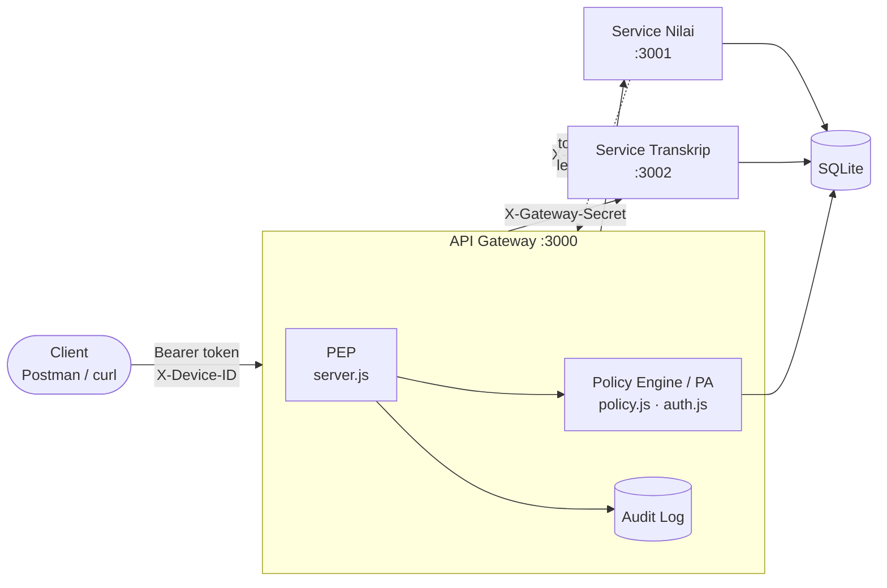

<div align="center">

# Sistem Nilai — Zero Trust Security

**API Gateway sebagai Policy Enforcement Point (PEP) · NIST SP 800-207**


Tugas Praktikum Individu · Keamanan Informasi (KP70065004)
Informatika, Universitas Siliwangi

**Mochammad Fasha Ajvikri · NPM 247006111178**

</div>

---

##  Daftar Isi

- [Gambaran Umum](#-gambaran-umum)
- [Arsitektur](#-arsitektur)
- [Struktur Proyek](#-struktur-proyek)
- [Cara Menjalankan](#-cara-menjalankan)
- [Akun dan Device ID](#-akun-dan-device-id)
- [Daftar Endpoint](#-daftar-endpoint)
- [Penerapan Zero Trust](#-penerapan-zero-trust)
- [Contoh Pengujian](#-contoh-pengujian)
- [Konfigurasi dan Reset Data](#-konfigurasi-dan-reset-data)
- [Catatan Keamanan](#-catatan-keamanan)

---

## Gambaran Umum

Sistem Nilai untuk program studi Informatika. Dosen menginput dan memfinalisasi nilai kelas yang diampunya, lalu nilai dikirim ke Service Transkrip. **Seluruh akses, termasuk panggilan antar-service, diperiksa oleh API gateway.**

| Role | Hak akses |
|---|---|
| Mahasiswa | Melihat nilai dan transkrip miliknya sendiri |
| Dosen | Melihat, mengubah, dan memfinalisasi nilai pada kelas yang diampu |
| Admin | Melihat transkrip seluruh mahasiswa |

---

## Arsitektur



| Komponen | Port | Peran NIST | Tanggung jawab |
|---|---|---|---|
| API Gateway | 3000 | **PEP** | Satu-satunya pintu masuk, memeriksa setiap request, mencatat audit, meneruskan ke service |
| Policy Engine / Administrator | di dalam gateway | **PE/PA** | Login, penerbitan dan pencabutan token, keputusan allow/deny |
| Service Nilai | 3001 | Resource | Data nilai dan kelas, finalisasi lalu sinkron ke transkrip |
| Service Transkrip | 3002 | Resource | Data transkrip mahasiswa |
| Database SQLite | - | Resource | Database bersama untuk kedua service |
| Audit Log | - | Data source | Tabel `audit_log`, ditulis oleh gateway |

---

## Struktur Proyek

```
SistemNilai-PraktikumKI/
├── database/
│   ├── db.js                 # koneksi SQLite dan skema tabel
│   └── seed.js               # data awal
├── gateway/                  # port 3000
│   ├── server.js             # PEP: verifikasi token, panggil policy, proxy
│   ├── policy.js             # Policy Engine: keputusan allow/deny + alasan
│   ├── auth.js               # PA: login, refresh, logout, token service
│   └── audit.js              # pencatatan audit log
├── service-nilai/            # port 3001
│   └── server.js
├── service-transkrip/        # port 3002
│   └── server.js
├── shared/
│   └── guard.js              # verifikasi gateway secret dan token di service
├── .env.example
└── package.json
```

---

## Cara Menjalankan

**Prasyarat:** Node.js 22.13 atau lebih baru (memakai `node:sqlite` bawaan, tanpa kompilasi tambahan).

```bash
# 1. Install dependensi
npm install

# 2. Siapkan konfigurasi
cp .env.example .env          # Windows PowerShell: Copy-Item .env.example .env
```

Isi setiap secret di `.env` dengan string acak yang **berbeda-beda**:

```bash
node -e "console.log(require('crypto').randomBytes(32).toString('hex'))"
```

```bash
# 3. Buat database dan data awal
npm run seed
```

Jalankan tiga server di **tiga terminal terpisah**:

| Terminal | Perintah | Hasil |
|---|---|---|
| 1 | `npm run start:gateway` | Gateway di port 3000 |
| 2 | `npm run start:nilai` | Service Nilai di port 3001 |
| 3 | `npm run start:transkrip` | Service Transkrip di port 3002 |

> Semua request dikirim ke gateway (`http://localhost:3000`). Port 3001 dan 3002 menolak akses langsung.

---

## Akun dan Device ID

Setiap user memiliki satu device terdaftar. Request dari device lain akan ditolak.

| Username | Password | Role | Device ID | Keterangan |
|---|---|---|---|---|
| `admin` | `admin123` | admin | `DEV-ADMIN-01` | - |
| `dosen1` | `dosen123` | dosen | `DEV-DOSEN-01` | Mengampu KI-101 |
| `dosen2` | `dosen123` | dosen | `DEV-DOSEN-02` | Mengampu JK-201 |
| `mhs1` | `mhs123` | mahasiswa | `DEV-MHS-01` | NPM 2410001 |
| `mhs2` | `mhs123` | mahasiswa | `DEV-MHS-02` | NPM 2410002 |
| `mhs3` | `mhs123` | mahasiswa | `DEV-MHS-03` | NPM 2410003 |

---

## Daftar Endpoint

Header wajib untuk request user: `Authorization: Bearer <access_token>` dan `X-Device-ID: <device>`.

| Endpoint | Ditangani oleh | Diizinkan | Kondisi |
|---|---|---|---|
| `POST /auth/login` | Gateway | Semua user | Kredensial valid dan device terdaftar |
| `POST /auth/refresh` | Gateway | Semua user | Refresh token valid dan belum dicabut |
| `POST /auth/logout` | Gateway | Semua user | Refresh token valid dan belum dicabut |
| `POST /auth/service` | Gateway | Service Nilai | Client ID dan secret valid |
| `GET /nilai` | Nilai | Mahasiswa, dosen | Mahasiswa: miliknya. Dosen: kelas yang diampu |
| `PUT /nilai/:id` | Nilai | Dosen | Kelas diampu, belum final, dalam jam akses |
| `POST /kelas/:id/finalisasi` | Nilai | Dosen | Kelas diampu, dalam jam akses, lalu sinkron ke transkrip |
| `GET /transkrip/:npm` | Transkrip | Mahasiswa, admin | Mahasiswa: NPM sendiri. Admin: semua |
| `POST /transkrip/sinkron` | Transkrip | Service Nilai | Hanya token service, token user ditolak |

---

## Penerapan Zero Trust

### Never trust, always verify

| Mekanisme | Lokasi kode |
|---|---|
| Setiap request di luar `/auth/*` melewati PEP: verifikasi token, device, dan kebijakan | `gateway/server.js` |
| Gateway menambahkan `X-Gateway-Secret`, service menolak akses langsung | `buatProxy` di `gateway/server.js`, `shared/guard.js` |
| Service memverifikasi ulang tanda tangan dan masa berlaku token, walau secret benar | `shared/guard.js` |
| Device harus terdaftar untuk user tersebut | `gateway/policy.js`, `gateway/auth.js` |
| Jam akses perubahan dan finalisasi nilai (dapat dikonfigurasi) | `jamAksesOk()` di `gateway/policy.js` |

### Least privilege

| Mekanisme | Lokasi kode |
|---|---|
| Akses per role dan per kepemilikan data (kelas, NPM, status final dibaca dari database, bukan dari isi token) | `gateway/policy.js` |
| Endpoint tanpa kebijakan otomatis ditolak (*default deny*) | `putuskan()` di `gateway/policy.js` |
| `/transkrip/sinkron` hanya menerima token service | `gateway/policy.js`, `shared/guard.js` |

### Assume breach

| Mekanisme | Lokasi kode |
|---|---|
| Access token 10 menit, token service 5 menit | `gateway/auth.js` |
| Refresh token 1 hari, disimpan sebagai **hash** di database, dapat dicabut | `gateway/auth.js`, tabel `refresh_tokens` |
| Token user dan token service memakai secret JWT yang berbeda | `.env`, `gateway/auth.js` |
| Audit log setiap keputusan: waktu, subjek, endpoint, device, hasil, alasan | `gateway/audit.js`, tabel `audit_log` |

---

## Contoh Pengujian

Contoh memakai PowerShell. Untuk Postman, kirim request yang sama ke `http://localhost:3000`.

**Login dan lihat transkrip sendiri**

```powershell
$r = Invoke-RestMethod -Method Post -Uri http://localhost:3000/auth/login `
  -Headers @{ "X-Device-ID" = "DEV-MHS-01" } -ContentType "application/json" `
  -Body '{"username":"mhs1","password":"mhs123"}'

$h = @{ Authorization = "Bearer $($r.access_token)"; "X-Device-ID" = "DEV-MHS-01" }
Invoke-RestMethod http://localhost:3000/transkrip/2410001 -Headers $h
```

**Skenario yang harus ditolak**

| Skenario | Hasil yang diharapkan |
|---|---|
| Request tanpa token | `401` |
| mhs1 membuka transkrip NPM lain | `403` |
| Device ID tidak terdaftar | `403` |
| Akses langsung ke `localhost:3001` atau `:3002` | `403` (gateway secret tidak valid) |
| Gateway secret benar tetapi tanpa token | `401` |
| Token user memanggil `/transkrip/sinkron` | `403` |
| Dosen mengubah nilai kelas dosen lain | `403` |
| Mengubah nilai yang sudah final | `403` |
| Mengubah nilai di luar jam akses | `403` |
| Refresh dengan token yang sudah di-logout | `401` |

Semua keputusan di atas tercatat di tabel `audit_log`:

```bash
node -e "const db=require('./database/db'); console.table(db.prepare('SELECT subjek,endpoint,device,hasil,alasan FROM audit_log ORDER BY id DESC LIMIT 20').all())"
```

---

## Konfigurasi dan Reset Data

**Jam akses.** Ubah `JAM_MULAI` dan `JAM_SELESAI` di `.env`, lalu restart gateway. Ini memudahkan demo penolakan di luar jam akses.

**Reset data.** Hentikan semua server, lalu:

```powershell
Remove-Item database\sistem-nilai.db*
npm run seed
```

---

## Catatan Keamanan

- File `.env` tidak ikut repository (ada di `.gitignore`). Gunakan `.env.example` sebagai acuan.
- Logout hanya mencabut **refresh token**. Access token yang sudah terbit tetap berlaku sampai masa 10 menitnya habis (sifat JWT stateless), karena itu masa berlakunya dibuat pendek.
- Akun dan password pada README ini hanya untuk data seed praktikum, bukan untuk penggunaan nyata.